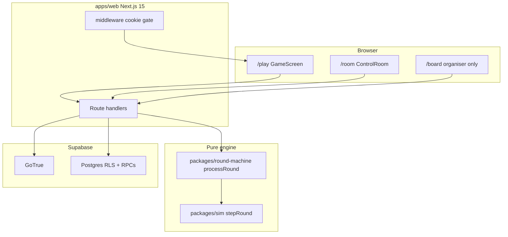
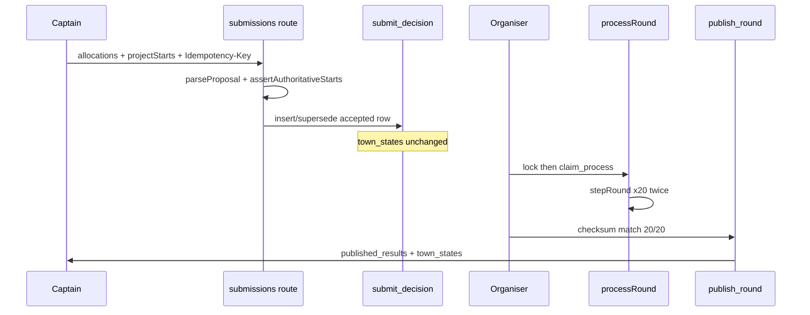
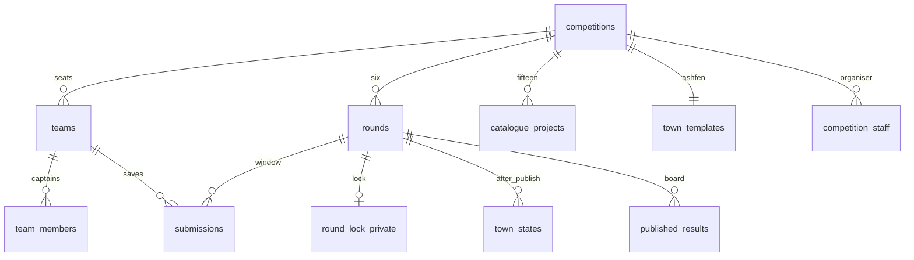

# Langlands R3 — complete project reference

**Date:** 2026-10-28  
**Tree:** `main` @ `2727d28` plus uncommitted work (preserved). Not committed, pushed, or deployed.  
**Hosted databases:** not written. Production CLI link `npwgkqfljrqhvuiateqk` was not used for `db push`.  
**Engine freeze:** `py-ref-1.1.0` / catalogue **A-CAT-1.1** / Pack A / 20 teams / 6 rounds / 18-minute window / 40·25·15·10·10.

Evidence labels used below: **VERIFIED IN CODE**, **VERIFIED BY TEST**, **DOCUMENTED INTENTION**, **INFERRED**, **NOT VERIFIED**, **BLOCKED**.

This document describes the **post-fix** tree after the Level A tick/provision secret repair in this audit.

---

## 1. Executive summary

Langlands R3 is a pedagogical 20-team environmental strategy competition. Captains manage identical copies of the fictional town Ashfen for six game-years. They allocate credits across eight sectors and may start at most two catalogue interventions per round. The server is authoritative: browsers propose allocations and codes; they never submit scores, remaining budgets, clocks, or simulation outcomes as truth.

**What works (local):** the TypeScript engine matches the Python goldens; all 15 catalogue projects and eight sectors have automated effect tests; PGlite walks save → supersede → lock → process (retry no-op) → publish across six rounds; captains cannot read rival submissions or private town state under local RLS; organisers can run the control room.

**What this audit fixed:** `GET /api/event/tick` no longer advances the live event from an organiser cookie (CSRF). Cron actors are scoped to `langlands-r3` staff. Provision and tick secrets are compared via SHA-256 + `timingSafeEqual`.

**Verdict:** **GO** for local / PGlite rehearsal of the game loop. **NO-GO** for a hosted hall or for deploying this uncommitted tree onto a live competition.

---

## 2. Product purpose and competition rules

**DOCUMENTED INTENTION** (`docs/product-specification.md`, `docs/game-rules.md`, `AGENTS.md`):

| Rule | Value |
| --- | --- |
| Teams | 20, seats 1–20, all start identical |
| Town | Ashfen |
| Currency | credits |
| Rounds | 6 (one game-year each) |
| Decision window | 18 minutes, then lock / process / publish together |
| Starts per round | at most 2 catalogue codes |
| Sectors | 8 (remainder is reserve) |
| Score weights | ecology 40, welfare 25, economy 15, resilience 10, efficiency 10 |
| Events | Pack A: R1 none, R2 HEATWAVE, R3 DROUGHT, R4 FLOOD, R5 CONTAMINATION, R6 none |
| Randomness | none per team; damage is a function of that town’s state |

This is a teaching game, not a validated Earth-system model. Coefficients are assumptions.

**VERIFIED IN CODE:** `packages/sim/src/constants.ts` (`ROUNDS = 6`, `MAX_STARTS = 2`, `WEIGHTS`, `PACK_A`, `STARTING_RESERVE = 220`).

---

## 3. Architecture and repository map



| Path | Role |
| --- | --- |
| `apps/web` | Next.js App Router UI and Node APIs |
| `packages/sim` | Pure TypeScript port of `docs/simulation/engine.py` |
| `packages/round-machine` | Submit / lock / process / publish helpers |
| `supabase/migrations` | Schema, RLS, RPCs, seed (`0001`–`0013`) |
| `supabase/tests` | PGlite isolation and lifecycle |
| `docs/` | Canonical specs |
| `docs/audits/` | Historical and this-session audits |
| `docs/simulation/` | Python lab, goldens, `official_score.py` |

`packages/sim-fixtures` is named in `docs/technical-architecture.md` and **does not exist**. Goldens live at `docs/simulation/goldens/py_ref_1_1_0.json`. **DOCUMENTED INTENTION** there is stale versus **VERIFIED IN CODE**.



---

## 4. Important files and their responsibilities

| File | Responsibility |
| --- | --- |
| `AGENTS.md` | Agent contract, freeze, ownership |
| `packages/sim/src/engine.ts` | Town physics, events, scoring snapshot |
| `packages/sim/src/catalogue.ts` | 15 interventions |
| `packages/round-machine/src/process.ts` | Official 20-team process + `meanDamage` |
| `packages/round-machine/src/validate.ts` | Save-time proposal validation |
| `packages/round-machine/src/machine.ts` | SQL wrappers for submit/open/lock/process/publish |
| `packages/round-machine/src/town.ts` | `parseTown` reconstruction |
| `apps/web/app/api/rounds/[id]/submissions/route.ts` | Captain save |
| `apps/web/lib/server/game-context.ts` | `/play` payload |
| `apps/web/lib/play-payload.ts` | Strips leaderboard for non-organisers |
| `apps/web/lib/board-access.ts` | Organiser-only board gate |
| `apps/web/lib/ranking.ts` | Official order: score → ecology → meanDamage → seat |
| `apps/web/lib/event-tick-plan.ts` | Automatic progression planner |
| `apps/web/lib/event-tick-auth.ts` | GET=cron secret only; POST=secret or session |
| `apps/web/lib/secret-match.ts` | Timing-safe secret compare |
| `apps/web/middleware.ts` | Cookie presence gate; not authorization |
| `supabase/migrations/0005_seed_event.sql` | `seed_langlands_r3()` |
| `supabase/migrations/0013_submit_supersede_with_auth.sql` | Accepted → superseded while JWT present |
| `docs/simulation/engine.py` | Python reference |

---

## 5. Complete gameplay specification (as implemented)

**Update order (must not change)** — **VERIFIED IN CODE** `stepRoundPy` in `packages/sim/src/engine.ts` (~596–637) and `docs/simulation-model.md`:

1. `applyDrift`
2. Project delayed landings (`applyPendingProjects`); mark completions
3. Operating delayed landings
4. Ongoing effects of projects completed in a **previous** round
5. `available = max(0, reserve + income − maintenance)`
6. Resolve starts (prereq / mutex / budget / max 2), charge starts, scale sector spend
7. Immediate effects; queue later landings
8. `applyEventPackA` (multipliers only if already completed)
9. `reserve = unspent`
10. Official snapshot

Charge order is **starts then sectors then reserve**. Catalogue intro text still says the opposite (**DOCUMENTED INTENTION** conflict — see §15).

Maintenance begins the round after a start. Ongoing begins the round after completion. Event multipliers apply only if the project is in `town.completed` at event time.

There is **no** extra crisis-response menu. Pack A is automatic.

---

## 6. Full catalogue of options and implementation status

Path for every option: UI `CommandDesk` / `projectsForSector` → `decision.ts` canonicalize → `parseProposal` + `assertAuthoritativeStarts` → `submit_decision` → lock manifest (`round_lock_private`) → `stepRound` → `town_states` JSON (`started`, `completed`, `pending`) → later `loadPreTown` → Pack A → `snapshot` / `finalScore`.

| ID | Display name | Cost | Build | Prereq / mutex | Timing | State / disasters | Tests | Classification |
| --- | --- | ---: | ---: | --- | --- | --- | --- | --- |
| `WETLAND` | Wetland restoration | 280 | 1 | — | T+1 water/bio/soil/buffer; ongoing | Flood ×0.85 | sim gameplay-validation | **WORKING AND VERIFIED** |
| `REFOREST` | Reforestation | 280 | 2 | — | T+1 air; T+2 bio/soil/buffer; ongoing | none (intended) | same | **WORKING AND VERIFIED** |
| `RIVER` | River cleanup | 240 | 0 | — | Immediate water/pollution; ongoing pollution | none | same | **WORKING AND VERIFIED** |
| `EMISSIONS` | Industrial emissions control | 260 | 1 | — | T+1 pollution/air; ongoing | none | same | **WORKING AND VERIFIED** |
| `WASTEWATER` | Wastewater upgrade | 300 | 1 | — | T+1 water/pollution/health | Contamination ×0.90 | same + water PGlite cousin | **WORKING AND VERIFIED** |
| `WATER_TREAT` | Emergency water treatment | 200 | 0 | — | Immediate water_q+6, health+2 | Drought ×0.90 | sim + PGlite lifecycle | **WORKING AND VERIFIED** |
| `GRID` | Grid repairs | 200 | 0 | — | Immediate energy/infra | enables tree | same | **WORKING AND VERIFIED** |
| `COAL` | Emergency thermal restart | 280 | 0 | GRID; ENERGY_BASELOAD | Immediate dirt/energy | none | same | **WORKING AND VERIFIED** |
| `RENEWABLES` | Wind and solar park | 360 | 2 | GRID; ENERGY_BASELOAD | T+2 energy/green_energy | none | same | **WORKING AND VERIFIED** |
| `REGEN_AG` | Regenerative farming | 260 | 1 | AGRI_PUSH | Immediate mix; T+1 soil/bio/economy | none | same | **WORKING AND VERIFIED** |
| `INTENSE_AG` | Intensive yield push | 240 | 0 | AGRI_PUSH | Immediate yield/stress; ongoing mix | none | same | **WORKING AND VERIFIED** |
| `FACTORIES` | Repair factories | 240 | 1 | GRID | T+1 economy/jobs/pollution | none | same | **WORKING AND VERIFIED** |
| `GREEN_MFG` | Green manufacturing | 280 | 1 | EMISSIONS+FACTORIES | T+1 cleanup; R6 start cannot complete | Contamination ×0.90 | same | **WORKING AND VERIFIED** |
| `FLOOD_WALL` | Flood defences | 300 | 1 | — | Immediate infra/prep; T+1 buffer | Flood ×0.75 | same | **WORKING AND VERIFIED** |
| `CLINICS` | Clinics | 240 | 0 | — | Immediate health/prep; ongoing; same-round shield | Contamination ×0.85 | same | **WORKING AND VERIFIED** |

Eight sectors (R1 spend-only vs silent hold; directions from `applyAllocations`): restoration↑bio, pollution_control↓pollution, water↑water_q, energy↑energy, agriculture↑jobs, industry↑economy, infrastructure↑infra, public_services↑health. **WORKING AND VERIFIED** for those directional effects. Exhaustive mix grids were not added; named mixes are covered by strategy tests.

**Crisis responses:** not a separate selectable class. **WORKING AND VERIFIED** as catalogue `eventMult` plus Pack A.

**UI-only gaps (not missing engine):** `startEligibility` does not check credits; `budgetCheck` and the save handler do. `assertAuthoritativeStarts` rejects a save the engine would silently drop. **IMPLEMENTED** UX, not broken physics.

**In-browser clicks** of every tile: **NOT VERIFIED**. UI unit tests prove all 15 codes render (`gameplay-options.test.ts`).

**Hosted save of each option:** **NOT VERIFIED** / **BLOCKED**.

---

## 7. Simulation engine and multi-round state lifecycle

**Python** `docs/simulation/engine.py` is the design lab. **TypeScript** `packages/sim` is what process uses. **VERIFIED BY TEST:** `packages/sim/tests/parity.test.ts` matches `py_ref_1_1_0.json` (silent score **6.42**, balanced **55.92**, hashes).

Town JSON persisted at **publish** includes indices, mix flags, `pending`, `started`, `completed`, `delayed`, `shock_log`. Next round loads the previous **published** `town_states` row (`loadPreTown` / `loadPreTownForTeam`). Round 1 uses `town_templates.initial_state`.

`parseTown` (`packages/round-machine/src/town.ts`) overlays JSON on `createInitialTown()` and re-binds collection fields. Malformed extra keys are not stripped (**INFERRED** robustness gap, not a known live bug).

**WATER_TREAT trace (R1 start, hold thereafter vs identical control):** **VERIFIED BY TEST** (`packages/sim/tests/gameplay-validation.test.ts`, `supabase/tests/gameplay-validation.test.ts`) and Python `play_interactive`.

| Round | Spec | Observed |
| ---: | --- | --- |
| 1 | Complete immediately, +6 water_q, +2 health, cost 200 | Δwater_q **+6.00**, unspent 954.06 vs 1154.06, no event |
| 2 | Maintenance 10; no heatwave multiplier | Maint 10 vs 0; heatwave 44.07 vs 45.27 via water_q only |
| 3 | Drought ×0.90 on **that town’s** formula | 39.59 vs control 45.49; matches `formula * 0.90` |
| 5 | Still owned; no contamination multiplier | multiplier 1.0; water_q still higher; score 7.19 vs silent 6.42 |

PGlite: save, resave supersedes, `town_states` empty until publish, process retry no-op, rounds 2–5 advanced with real `open_round` / `lockRound` / `processClaimedRound` / `publishWithRecompute`. Seat 1 drought `shock_log[2]` < hold seat.

Temporarily setting `eventMult.DROUGHT = 1` in-memory makes the 0.90 assertion fail; restored in `afterEach`.

---

## 8. Credit accounting, scoring and ranking

```
income = 180 + (180 if round 1) + 8.6·economy + 3.2·jobs + 1.6·fiscal
       − 0.45·pollution − 0.40·(100−health) − 0.30·(100−energy)
available = max(0, opening_reserve + income − maintenance)
STARTING_RESERVE = 220
R1 available on a silent town ≈ 1154.06
```

**VERIFIED BY TEST:** save does not charge; process computes; publish writes towns. Second process is `noop`. Identity `projectCost + sectorSpend + unspent = available`.

Official snapshot uses published weights and dysfunction floors. `final_score = round(0.62·last + 0.38·mean, 2)` with Python 3 bankers’ rounding (`pythonRound`).

Ranking **VERIFIED IN CODE** `compareOfficial` (`apps/web/lib/ranking.ts` 72–80): higher score, higher ecology, lower `meanDamage`, lower seat. Missing `meanDamage` skips that step (does not invent 0). Process writes `meanDamage` onto `score_breakdown`. Extra JSON keys are allowed by the CHECK (seven required keys).

Delegates do not receive `leaderboard` / `boardByRound` in `/api/play/context`. `GET /api/play/board` is 403 unless organiser. **VERIFIED BY TEST.** PostgREST `published_results_read` still lets any competition participant `SELECT` all published TownPublic rows after publish (**VERIFIED IN CODE** `0004` policy ~488–505). UI hide ≠ RLS hide. See §15.

---

## 9. Database schema, relationships and migration history

Canonical live schema is **`supabase/migrations/`**, not `docs/schema.sql` (that file is labelled specification-only and is stale).

| Migration | Purpose |
| --- | --- |
| 0001 | Core tables, enums, first RLS |
| 0002 | Official score columns |
| 0003 | Profile on signup |
| 0004 | team_count=6 round freeze, Pack A, permission matrix, `published_results` |
| 0005 | `seed_langlands_r3()` — slug `langlands-r3`, 20 seats, 6 rounds, 15 catalogue rows |
| 0006 | Round-machine RPCs |
| 0007 | `login_id` / `password_hash` |
| 0008 | Disqualified submit reject |
| 0009 | `round_lock_private`; public lock summary |
| 0010 | 18-minute `open_round`; window / reopen |
| 0011 | Restore unpublished void |
| 0012 | Column grants: `password_hash` not selectable by `authenticated` |
| 0013 | Supersede accepted while `auth.uid()` is set |



`seed_langlands_r3()` is hardcoded to slug `langlands-r3` and **updates** that row on conflict when status is `draft` or `ready`. Calling it on a live `ready` event mutates it. **VERIFIED IN CODE** `0005`. There is no create-competition API.

---

## 10. Authentication, permissions and security

| Concern | Implementation | Evidence |
| --- | --- | --- |
| Team login | `login_id` + bcrypt; GoTrue alias `team-${id}@users.langlands.internal` | **VERIFIED IN CODE** `apps/web/app/api/auth/login/route.ts` |
| Login uniqueness | `login_id` unique per competition, lookup is **global** `.eq("login_id")` | **VERIFIED IN CODE** — collision if two events share IDs |
| Organiser login | staff email, not Team ID | **VERIFIED IN CODE** |
| Middleware | Cookie presence only; APIs use `requireUser` | **VERIFIED IN CODE** `middleware.ts` |
| RLS submissions | own team (+ organiser) | **VERIFIED BY TEST** isolation suite |
| RLS town_states | own team (+ organiser) | **VERIFIED BY TEST** |
| lock_manifest | public summary; allocations in `round_lock_private` (no browser GRANT) | **VERIFIED BY TEST** locally; **NOT VERIFIED** hosted |
| password_hash | column revoke 0012 | **VERIFIED BY TEST** PGlite |
| Board API | organiser staff row required | **VERIFIED BY TEST** |
| Tick GET | cron Bearer only (this audit) | **VERIFIED BY TEST** `event-tick-auth.test.ts` |
| Provision | `TEAM_PROVISION_SECRET` required; refuses production ref unless `ALLOW_HOSTED_PROVISION` | **VERIFIED IN CODE** `supabase-target.ts` |
| Anon key in browser | required for Auth; `createBrowserSupabase` is unused by UI | **VERIFIED IN CODE**; PostgREST still reachable **INFERRED** |
| Hosted rival probe | — | **NOT VERIFIED** |

Service role is server-only (`SUPABASE_SERVICE_ROLE_KEY`). `NEXT_PUBLIC_SUPABASE_SERVICE_ROLE_KEY` is forbidden (`createServiceRoleClient` throws).

---

## 11. Round lifecycle and organiser operations

Statuses: `scheduled → open → locked → processing → published`. `void` is recoverable to `scheduled` via `restore_voided_round` if unpublished (0011). Predecessor must be `published` to open the next round.

| API | Who | Effect |
| --- | --- | --- |
| `POST /api/event/start` | organiser | sets competition `live`; opens round 1 if scheduled. Hardcoded slug `langlands-r3` |
| `POST /api/event/pause` | organiser | `paused` / resume `live` |
| `POST /api/event/tick` | organiser session | one planner step |
| `GET /api/event/tick` | Bearer `EVENT_TICK_SECRET` or `CRON_SECRET` only | Vercel Cron |
| `POST /api/rounds/:id/open\|lock\|process\|publish\|window\|reopen\|void\|restore` | organiser of that round’s competition | RPCs |
| `POST /api/rounds/:id/submissions` | seated captain | save |
| `GET /api/rounds/:id/support/:teamId` | organiser | support read |

`planEventTick` auto-opens the next scheduled round after publish when status is `live`. Pause disables it. **VERIFIED BY TEST** `event-tick-plan.test.ts`.

`apps/web/vercel.json` schedules `GET /api/event/tick` every minute. Deploying that with a tick secret on a **live** competition will lock/process/publish/open without a human. **DOCUMENTED INTENTION** for event day; **BLOCKED** as a silent production deploy.

Control room: `apps/web/components/room/ControlRoom.tsx` — POST tick, manual buttons, no allocations in HTTP lock echo (`private-lock.ts`).

---

## 12. Frontend routes, map, and UX

| Route | Audience | Notes |
| --- | --- | --- |
| `/` | public | landing |
| `/sign-in` | public | Team ID or organiser email |
| `/rules` | public | catalogue from `CATALOGUE` |
| `/play` and `/play/decide\|results\|history` | seated | map-first command screen |
| `/play/fixture` | **non-production only** | `notFound()` in production |
| `/board` | organiser | 20-town standings |
| `/room`, `/room/team/[seat]` | organiser | control / support |

Map: `TownMap.tsx` / `GameMap.tsx` / `DistrictPanel.tsx` — districts highlight by sector. Design: dark forest / amber (`#0E1512`, `#B89A60`). HUD countdown ticks locally from `serverNow` (`clock.ts` `remainingMs` with `sampledAt`). **VERIFIED BY TEST** `clock.test.ts`.

Clients send only `allocations`, `projectStarts`, `idempotencyKey` (`trust.ts`). Applied unspent shown after save is a **dry-run preview**, labelled as such in save copy.

---

## 13. Test inventory and actual verification results

Commands run **this session** (not reused from older audits):

```
npm run test:sim     # 6 files, 121 passed
npm run test:web     # 21 files, 112 passed
npm run test:db      # 7 files,  46 passed
python3 -m unittest discover -s docs/simulation -p 'test_*.py'  # 35 passed
npm run typecheck    # pass
npm run lint         # pass
npm run build        # Next.js 15.5.28 pass
```

**0 failures.**

| Suite | What it proves |
| --- | --- |
| `packages/sim/tests/parity.test.ts` | TS = Python golden |
| `engine.test.ts` / `interventions.test.ts` | budget, mutex, delays, Pack A, maintenance |
| `gameplay-validation.test.ts` | all 15 projects, 8 sectors, WATER_TREAT, mutation |
| `strategy-balance.test.ts` / `twenty-team-campaign.test.ts` | mixes, 20 silent hashes |
| `supabase/tests/isolation.test.ts` | rival privacy, lock summary, published columns |
| `submit-supersede.test.ts` | 0013 resave; process charges once |
| `event-day-dress-rehearsal.test.ts` | 20 seats × 6 rounds, five strategies |
| `gameplay-validation.test.ts` (PGlite) | WATER_TREAT save/resave/persist through R5 |
| `apps/web/lib/event-tick-auth.test.ts` | GET needs secret |
| `secret-match.test.ts` | timing-safe compare |
| `board-access.test.ts` / `play-payload.test.ts` | organiser board, stripped player payload |
| `ranking.test.ts` | tie-break including meanDamage |

**Not run:** hosted PostgREST as a rival, Playwright, Vercel Cron against a cloud project, `supabase db push`.

---

## 14. Confirmed issues fixed (this audit and still-uncommitted prior work)

### This audit (Level A)

| Issue | Fix | Tests |
| --- | --- | --- |
| `GET /api/event/tick` aliased POST, so an organiser session GET could lock/process/publish/open (CSRF) | `classifyEventTickAuth`: GET requires Bearer secret; POST may use secret or organiser session | `event-tick-auth.test.ts` |
| Cron actor was first organiser **globally**, not of `langlands-r3` | `competition_staff` filtered by competition id | code review of `tick/route.ts` |
| Secret header compared with `===` | `secretsMatch` SHA-256 + `timingSafeEqual`; also used by provision | `secret-match.test.ts` |

Files: `apps/web/lib/secret-match.ts`, `apps/web/lib/event-tick-auth.ts`, `apps/web/app/api/event/tick/route.ts`, `apps/web/app/api/admin/provision-teams/route.ts`, matching `*.test.ts`.

### Already in the uncommitted tree (not reverted)

- 0013 accepted→superseded save fix
- Organiser-only `/board` and stripped play payload
- `meanDamage` tie-break persistence
- 18-minute windows, void restore, private locks (migrations 0009–0011, committed at HEAD plus docs)
- Player/organiser UX, event start/pause/tick planner, gameplay validation tests

Scoring **weights**, catalogue **costs**, and Pack A **formulas** were not changed in this audit.

---

## 15. Unresolved issues and decisions requiring approval

### Level B — investigate, wait

1. **Charge-order prose.** `docs/interventions-catalogue.md` still says starts attach after operating allocations. `docs/game-rules.md` and the engine charge starts first. `docs/simulation-model.md` already resolved in favour of game-rules. **Recommendation:** edit the catalogue sentence to match the freeze. Does not change numbers.
2. **Contamination shields in `docs/environmental-events.md`.** Catalogue/engine apply `CLINICS` ×0.85, `WASTEWATER` ×0.90, `GREEN_MFG` ×0.90 (stack). Events doc names only `CLINICS`. **Recommendation:** list the catalogue multipliers in the events doc. Does not change engine math.
3. **Published board vs RLS.** UI and `/api/play/board` are organiser-only (`game-rules.md` updated). RLS `published_results_read` still allows any participant to `SELECT` every published TownPublic row. Tightening that is a **migration** and changes what a captain can read with the anon key. **Recommendation:** add a policy “own row unless organiser/judge” after you confirm hall policy. Do not apply to hosted from an agent.
4. **Single-competition app.** Play/staff `limit(1)`; login is global by `login_id`; start/tick/provision default slug `langlands-r3`. A second event on the same project is schema-legal and **unsupported**. Isolated hosted rehearsal needs a **new empty project**, not a second slug on the current rehearsal DB (see prior isolation plan).
5. **`technical-architecture.md` stale** (0001–0006, “no play UI yet”, missing sim-fixtures package). Doc-only refresh.

### Level C — do not do without explicit approval

- Deploy, commit, push, `supabase db push`, or hosted SQL.
- Opening rounds on existing `langlands-r3` (rehearsal has R1–R3 published; do not open R4 there).
- Changing weights, costs, Pack A damage, round count, team count.
- Enabling `ALLOW_HOSTED_PROVISION` against production `npwgkqfljrqhvuiateqk`.
- Shipping `vercel.json` cron to a project whose competition status is `live` unless you want automatic progression.
- Rewriting RLS on hosted `published_results`.

---

## 16. Git and uncommitted-change status

- Branch: `main` @ `2727d28` — *Document round restore, private locks, and isolated provisioning.*
- Remote: not pushed. No commit created.
- Working tree: **dirty**. Prior HUD/save/board/ranking/tick/audit files remain. This audit added tick-auth helpers and this reference.
- `supabase/.temp/project-ref` = production `npwgkqfljrqhvuiateqk`. **Never `db push` from this checkout.**
- Secrets: `.env*.local`, `.organiser-local.json`, `.team-credentials.local.json` gitignored. Values not printed.

---

## 17. Release blockers and go/no-go

| Target | Verdict | Why |
| --- | --- | --- |
| Local PGlite six-round loop | **GO** | 20×6 dress rehearsal, WATER_TREAT persistence, 0013 resave, isolation tests green |
| Local `next dev` against a disposable empty project | **CONDITIONAL GO** | Needs operator-created project, migrations 0001–0013, provision 20 IDs, local env only |
| Hosted rehearsal project `fgqitafevklmuhybuwzw` existing `langlands-r3` | **NO-GO** for opening rounds | R1–R3 already published; opening any round affects all 20 live seats |
| Second event on that project | **NO-GO** without product work | seed would mutate `ready` slug; app cannot select a second slug safely |
| Production hall / Vercel deploy of this tree | **NO-GO** | Uncommitted, CLI linked to production, no CI, hosted RLS/board policy undecided, cron would auto-progress if `live` + tick secret |
| Hosted dummy captain save on live event | **NO-GO** | Forbidden by operator rules; 0013 presence on rehearsal was confirmed earlier, but no safe open round |

---

## 18. Safe setup and testing instructions

Do **not** point these at production.

```bash
# Isolated engine and DB (safe anytime)
npm run test:sim
npm run test:db
npm run test:web
python3 -m unittest discover -s docs/simulation -p 'test_*.py'
npm run typecheck
npm run lint
```

PGlite applies `0001`–`0013` in `supabase/tests/harness.ts`. It does not read `.env.local`.

For a disposable cloud project (operator, not this agent): dashboard SQL in filename order 0001–0013; copy keys into `apps/web/.env.local` only; `npm run organiser:local`; provision 20 dummy IDs via `POST /api/admin/provision-teams`. Never `supabase db push` while `.temp/project-ref` is production.

---

## 19. Next-agent handover

1. Read `AGENTS.md` and this file. Do not commit unless asked.
2. Preserve the dirty tree. Do not stash.
3. Do not open hosted rounds. Do not `db push`.
4. If asked to document charge-order / contamination shields, that is Level B — wait for the operator.
5. If asked for a hosted save test, the supported isolation is a **new empty** Supabase project, not a second slug on `fgqitafevklmuhybuwzw`.
6. Automatic progression is opt-in: competition `live` + tick secret + cron. Pause stops it. GET tick no longer accepts cookies.
7. Official process path is TypeScript `packages/sim` via `processRound`, not the browser and not `score_lab.py` (that file still contains a non-Pack-A event).

---

## 20. Source index (paths and lines)

| Topic | Location |
| --- | --- |
| Freeze | `AGENTS.md` 69–76 |
| `stepRound` order | `packages/sim/src/engine.ts` 586–637 |
| Catalogue | `packages/sim/src/catalogue.ts` 17–256 |
| Pack A formulas | `packages/sim/src/engine.ts` 307–367 |
| `processRound` + meanDamage | `packages/round-machine/src/process.ts` 37–72, 120–154 |
| Save validation | `packages/round-machine/src/validate.ts` 71–124 |
| `parseTown` | `packages/round-machine/src/town.ts` 3–19 |
| Play context | `apps/web/lib/server/game-context.ts` 157–396 |
| Strip board | `apps/web/lib/play-payload.ts` |
| Board gate | `apps/web/lib/board-access.ts` 5–7 |
| Ranking | `apps/web/lib/ranking.ts` 61–80 |
| Tick planner | `apps/web/lib/event-tick-plan.ts` 17–83 |
| Tick auth | `apps/web/lib/event-tick-auth.ts` 13–32 |
| Tick route | `apps/web/app/api/event/tick/route.ts` |
| Login | `apps/web/app/api/auth/login/route.ts` 106–111 |
| Seed | `supabase/migrations/0005_seed_event.sql` |
| Supersede | `supabase/migrations/0013_submit_supersede_with_auth.sql` |
| published_results RLS | `supabase/migrations/0004_phase2_hardening.sql` 488–505 |
| Private lock | `supabase/migrations/0009_lock_manifest_privilege.sql` |
| Windows | `supabase/migrations/0010_round_windows.sql` `open_round` |
| Goldens | `docs/simulation/goldens/py_ref_1_1_0.json` |
| Cron | `apps/web/vercel.json` |

---

## What this task changed versus earlier audits

- **New:** tick GET CSRF fix, competition-scoped cron actor, timing-safe secrets, this reference.
- **Unchanged:** scoring weights, catalogue numbers, Pack A, hosted data, git history.
- **Still true from earlier audits:** 0013 resave, organiser board, meanDamage ranking, PGlite 20×6 GO, hosted hall NO-GO.
